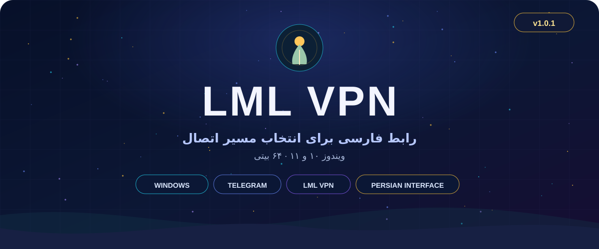
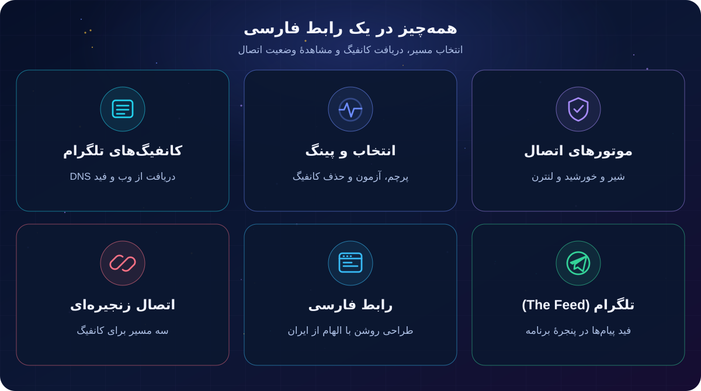
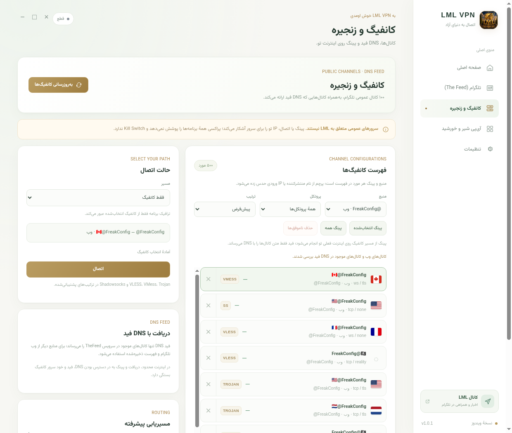
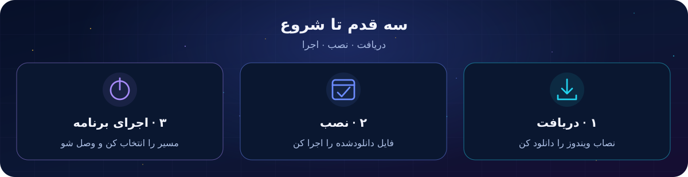

 

[**صفحهٔ انتشار نسخهٔ ۱.۰.۱**](https://github.com/nukesamp-crypto/LML-VPN/releases/tag/v1.0.1) &nbsp; · &nbsp; [کانال تلگرام LML](https://t.me/LML_panel) &nbsp; · &nbsp; [مجوزها و منابع](THIRD-PARTY-NOTICES.md)

 

  

## LML VPN چیست؟

**LML VPN** یک برنامهٔ فارسی است که انتخاب موتور اتصال، کانفیگ‌های عمومی تلگرام و مشاهدهٔ وضعیت اتصال را در یک رابط کنار هم قرار می‌دهد. طراحی روشن برنامه از **سرو، خورشید و پاسارگاد** الهام گرفته است.

> یک رابط فارسی؛ چند مسیر برای اتصال.

### ✦ در یک نگاه

- **موتورهای اتصال:** انتخاب شیر و خورشید یا لنترن، انتخاب کشور در صورت ارائهٔ موتور و مشاهدهٔ مدت اتصال.
- **کانفیگ‌های تلگرام:** بررسی ۱۰۰ کانال عمومی از وب، در کنار کانال‌هایی که خود TheFeed از طریق DNS ارائه می‌کند؛ فهرست قبلی برای استفادهٔ بعدی ذخیره می‌شود.
- **نام یکسان، انتخاب جداگانه:** همهٔ کانفیگ‌ها با نام **`LML VPN`** نمایش داده می‌شوند؛ شماره، منبع، پروتکل، پرچمِ موجود و پینگ کمک می‌کنند هر مورد را جداگانه انتخاب کنی.
- **پینگ و مدیریت:** آزمون انتخابی یا گروهی، فیلتر منبع و پروتکل، مرتب‌سازی، حذف تکی و حذف گروهی مواردی که آزمونشان ناموفق بوده است.
- **چند مسیر:** اتصال مستقیم کانفیگ، سایفون از مسیر کانفیگ یا کانفیگ از مسیر سایفون، با تنظیمات مسیریابی برای مسیرهای پشتیبانی‌شده.
- **تلگرام (The Feed):** نمایش فید در پنجرهٔ برنامه با رابط روشن و معرفی پروژه پیش از ورود.
- **آی‌پی شیر و خورشید:** تنظیم IP یا CIDR لبهٔ CDN و دسترسی به موتورهای مستقل در یک بخش.

## نمای برنامه

  

 
.

## دانلود و نصب ویندوز

  

<b>قدم ۱: دریافت فایل</b>

 
روی دکمهٔ دانلود بالا بزن؛ یا در <a href="https://github.com/nukesamp-crypto/LML-VPN/releases/tag/v1.0.1">صفحهٔ نسخهٔ ۱.۰.۱</a> فایل <b>LML-VPN-Setup-1.0.1.exe</b> را انتخاب کن.

<b>قدم ۲: نصب برنامه</b>

 
پوشهٔ Downloads را باز کن، روی فایل دانلودشده دو بار کلیک کن و مراحل نصاب را دنبال کن. نصب سراسری و سرویس لنترن به دسترسی Administrator نیاز دارند.

<b>قدم ۳: اجرا و اتصال</b>

 
LML VPN را از منوی Start یا میان‌بُر دسکتاپ باز کن، موتور یا کانفیگ دلخواه را انتخاب کن و دکمهٔ اتصال را بزن.

 

نصاب امضای تجاری ندارد و ممکن است Windows SmartScreen پیام نشان دهد؛ پیش از اجرا منبع فایل را بررسی کن. فایل **`SHA256SUMS.txt`** در صفحهٔ انتشار برای مقایسهٔ هش با یک ابزار گرافیکی در دسترس است؛ تطبیق هش به‌تنهایی هویت ناشر را ثابت نمی‌کند. پیش از جایگزینی نصب قبلی، از تنظیمات و پروفایل‌های مهم پشتیبان بگیر. برنامه به‌روزرسان خودکار مبتنی بر GitHub ندارد.

## نکته‌های کاربردی

- فید DNS فقط کانال‌هایی را بازمی‌گرداند که سرویس TheFeed ارائه می‌کند؛ حضور یک کانال در فهرست ۱۰۰تایی وب به معنی حضور آن در فید DNS نیست. دسترسی به وب، فید و سرورهای کانفیگ به شرایط شبکه بستگی دارد.
- پرچم از نام اصلی منتشرکننده یا برآورد کشور IP ورودی به دست می‌آید؛ این پرچم الزاماً کشور خروجی نیست. اگر داده‌ای در دسترس نباشد، کشور نامشخص می‌ماند.
- پینگ نشان‌داده‌شده، زمان آزمون HTTPS از مسیر کانفیگ یا پراکسی شیر و خورشید است و با پینگ ICMP یکسان نیست؛ برای مسیری که اندازه‌گیری در دسترس نباشد خط تیره نشان داده می‌شود.
- کانفیگ‌های عمومی متعلق به LML نیستند؛ پینگ یا اتصال، IP کاربر را برای سرور آشکار می‌کند. پراکسی ویندوز VPN تمام‌دستگاهی یا Kill Switch نیست و همهٔ برنامه‌ها الزاماً از آن پیروی نمی‌کنند.
- قوانین مسیریابی کانفیگ در حالت «سایفون از کانفیگ» اعمال نمی‌شوند. ورود دستی کانفیگ، اشتراک و QR در این صفحه وجود ندارد.

## پروژه‌ها و مجوزها

LML VPN یک پروژهٔ مستقل است که از اجزای زیر استفاده می‌کند:

| پروژه | نقش در LML VPN |
| :--- | :--- |
| [**ZedSecure**](https://github.com/CluvexStudio/ZedSecure-Cores) | هستهٔ Xray برای کانفیگ‌ها و مسیرهای زنجیره‌ای |
| [**TheFeed**](https://github.com/sartoopjj/thefeed) | فید کانال‌ها و پیام‌ها و دریافت محتوای فید از طریق DNS |
| [**Lantern**](https://github.com/getlantern/lantern) | هستهٔ Radiance برای موتور لنترن |
| [**شیر و خورشید**](https://github.com/shirokhorshid/shirokhorshid-android) | هستهٔ Psiphon و تنظیم IP و CIDR مربوط به آن |

مبدأ، حق نشر و مجوز اجزا در [اعلان اجزای شخص ثالث](THIRD-PARTY-NOTICES.md) آمده است. LML VPN محصول رسمی یا تأییدشدهٔ پروژه‌های بالا نیست. کد LML تحت [GPL-3.0-or-later](LICENSE) و اجزای همراه تحت مجوزهای مستقل خود عرضه می‌شوند. سورس برنامه در [`windows/`](windows/) و توضیحات ساخت در [راهنمای توسعه‌دهندگان](docs/BUILD-WINDOWS.md) قرار دارد.

 
✦ &nbsp; انتخاب با تو &nbsp; ✦
  
<a href="https://t.me/LML_panel">کانال تلگرام LML</a> · <a href="https://github.com/nukesamp-crypto/LML-VPN/releases/tag/v1.0.1">صفحهٔ انتشار</a> · <a href="THIRD-PARTY-NOTICES.md">مجوزها و منابع</a>

