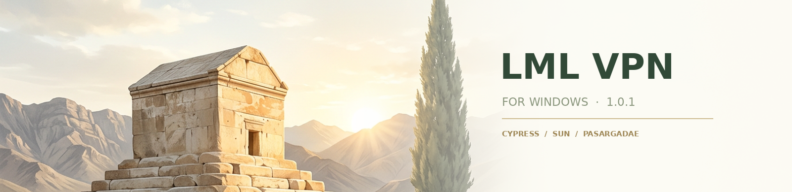

<div align="center">
  

  # LML VPN
  **انتخاب با تو؛ یک رابط فارسی برای مسیرهای مختلف اتصال**

  نسخهٔ **۱.۰.۱** &nbsp; · &nbsp; ویندوز ۱۰ و ۱۱، ۶۴بیتی &nbsp; · &nbsp; رابط HTML / CSS

  [⬇️ دریافت LML VPN](https://github.com/nukesamp-crypto/LML-VPN/releases/tag/v1.0.1) &nbsp; · &nbsp; [راهنمای ساخت](docs/BUILD-WINDOWS.md) &nbsp; · &nbsp; [مجوزها و منابع](THIRD-PARTY-NOTICES.md)
</div>

<div dir="rtl">

## ✦ پروژه‌هایی که کنار هم قرار گرفته‌اند

LML VPN یک رابط مستقل است که با استفاده از کار پروژه‌های زیر ساخته شده است؛ از سازندگان و مشارکت‌کنندگان آن‌ها سپاسگزاریم:

| پروژه | نقش در LML VPN |
| :--- | :--- |
| [**ZedSecure**](https://github.com/CluvexStudio/ZedSecure-Cores) | هستهٔ Xray برای کانفیگ‌های عمومی و مسیرهای زنجیره‌ای |
| [**TheFeed**](https://github.com/sartoopjj/thefeed) | رابط کانال‌ها و پیام‌ها و دریافت محتوای فید از طریق DNS |
| [**Lantern**](https://github.com/getlantern/lantern) | هستهٔ Radiance برای موتور لنترن در برنامه |
| [**شیر و خورشید**](https://github.com/shirokhorshid/shirokhorshid-android) | هستهٔ Psiphon و تنظیم آدرس‌های IP و CIDR مربوط به آن |

هر پروژه مجوز و هویت خود را دارد؛ LML VPN محصول رسمی یا تأییدشدهٔ آن‌ها نیست. جزئیات کامل در [اعلان اجزای شخص ثالث](THIRD-PARTY-NOTICES.md) آمده است.

---

## ☀️ ساده، روشن، الهام‌گرفته از ایران

از **سرو** و **خورشید** تا سنگ‌های **پاسارگاد**، طراحی نسخهٔ جدید با رنگ‌های روشن، سبز آرام و جزئیات طلایی شکل گرفته است. موتور اتصال، کشور، وضعیت، زمان اتصال و پینگ مسیر را از یک صفحه ببین.

</div>


<div align="center"><sub>تصویر رابط برنامه در یک چیدمان نمایشی شبیه دسکتاپ ویندوز</sub></div>

<div dir="rtl">

## ✨ چه چیزهایی در برنامه هست؟

- **مرکز اتصال:** انتخاب شیر و خورشید یا لنترن، انتخاب کشور در صورت ارائهٔ موتور و مشاهدهٔ مدت اتصال.
- **پینگ اندازه‌گیری‌شده:** آزمون HTTPS از مسیر کانفیگ یا پراکسی شیر و خورشید؛ زمان پاسخ نمایش داده می‌شود و با پینگ ICMP یکسان نیست. برای مسیری که اندازه‌گیری در دسترس نیست، خط تیره می‌بینی.
- **کانفیگ و زنجیره:** بررسی **۱۰۰ کانال عمومی تلگرام** از وب، کنار کانال‌هایی که خود فید DNS در اختیار می‌گذارد؛ همراه با فهرست ذخیره‌شده برای زمانی که دریافت تازه در دسترس نیست.
- **فهرستی مرتب‌تر:** فیلتر منبع و پروتکل، آزمون انتخابی یا گروهی، حذف تکی حتی پیش از پینگ و حذف گروهی فقط مواردی که آزمونشان ناموفق بوده است.
- **پرچم با توضیح منبع:** پرچم از نام منتشرکننده یا برآورد کشور IP ورودی به دست می‌آید. اگر داده‌ای در دسترس نباشد، کشور نامشخص می‌ماند؛ این پرچم الزاماً کشور خروجی نیست.
- **اتصال مستقیم:** با انتخاب کانفیگ و زدن «اتصال»، درخواست بدون پنجرهٔ تأیید اضافی آغاز می‌شود.
- **تلگرام (The Feed):** رابط TheFeed در خود پنجره با ظاهر روشن، و معرفی صفحهٔ GitHub پروژه پیش از نمایش آن.
- **آی‌پی شیر و خورشید:** تنظیم IP یا CIDR لبهٔ CDN و انتخاب موتورهای مستقل در یک بخش.
- سه مسیر برای کانفیگ: **فقط کانفیگ، سایفون از مسیر کانفیگ، یا کانفیگ از مسیر سایفون**، همراه با تنظیمات مسیریابی. قوانین مسیریابی کانفیگ در حالت «سایفون از کانفیگ» اعمال نمی‌شوند.

</div>


<div dir="rtl">

### دربارهٔ دریافت از DNS

فید DNS فقط کانال‌هایی را بازمی‌گرداند که سرویس TheFeed واقعاً ارائه می‌کند؛ قرار گرفتن یک کانال در فهرست ۱۰۰تایی به معنی حضور آن در فید DNS نیست. وب، DNS، خود سرورها و آزمون اتصال به شرایط شبکه وابسته‌اند. اگر دریافت تازه ممکن نباشد، آخرین فهرست ذخیره‌شده نمایش داده می‌شود. منبع هر کانفیگ در فهرست مشخص است.

## ⬇️ دریافت و نصب

1. از [صفحهٔ نسخهٔ ۱.۰.۱](https://github.com/nukesamp-crypto/LML-VPN/releases/tag/v1.0.1)، فایل **`LML-VPN-Setup-1.0.1.exe`** را دریافت کن.
2. هش فایل را با **`SHA256SUMS.txt`** همان انتشار مقایسه کن. در PowerShell:

   ```powershell
   Get-FileHash .\LML-VPN-Setup-1.0.1.exe -Algorithm SHA256
   ```

3. نصاب را اجرا کن. نصب سراسری و سرویس لنترن به دسترسی **Administrator** نیاز دارند؛ پس از نصب برنامه از Start یا میان‌بُر دسکتاپ در دسترس است.

نصاب امضای تجاری ندارد و ممکن است Windows SmartScreen پیام نشان دهد. تطبیق هش به‌تنهایی هویت ناشر را ثابت نمی‌کند. پیش از جایگزینی نصب قبلی، از تنظیمات و پروفایل‌های مهم پشتیبان بگیر. این نسخه به‌روزرسان خودکار مبتنی بر GitHub ندارد.

## 🧭 چند نکتهٔ کاربردی

- کانفیگ‌های عمومی متعلق به LML نیستند؛ پینگ یا اتصال، IP کاربر را برای سرور آشکار می‌کند.
- سایفون و کانفیگ‌ها در حالت پراکسی ویندوز، VPN تمام‌دستگاهی یا Kill Switch نیستند و همهٔ برنامه‌ها الزاماً از پراکسی پیروی نمی‌کنند.
- ورود دستی کانفیگ، اشتراک و QR در این صفحه وجود ندارد. اتصال و دسترسی به سرویس‌ها به شبکه و سرورهای مستقل بستگی دارد.
- سورس رابط و برنامه در [`windows/`](windows/) است. آرشیو سورس انتشار، درخت‌های بالادستی پین‌شده و راهنمای وابستگی‌ها را هم در بر می‌گیرد. کد LML تحت [GPL-3.0-or-later](LICENSE) و اجزای همراه تحت مجوزهای مستقل خود عرضه می‌شوند.

<div align="center">
  <br>
  ✦ &nbsp; برای انتخاب مسیر، برای ارتباط &nbsp; ✦
  <br><br>
  <a href="https://t.me/LML_panel">کانال تلگرام LML</a> · <a href="THIRD-PARTY-NOTICES.md">اعلان و مجوز پروژه‌ها</a>
</div>

</div>
